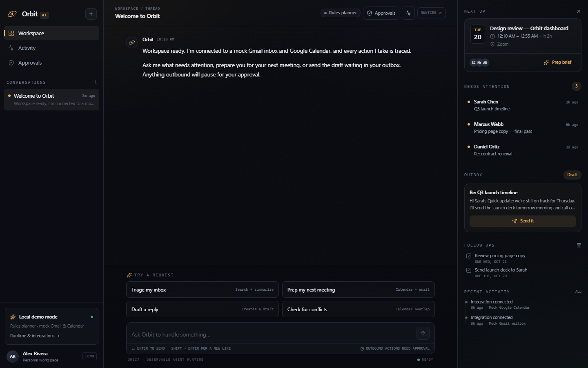
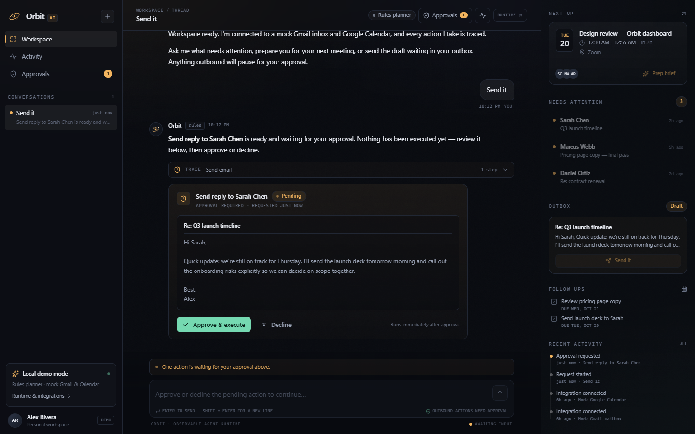
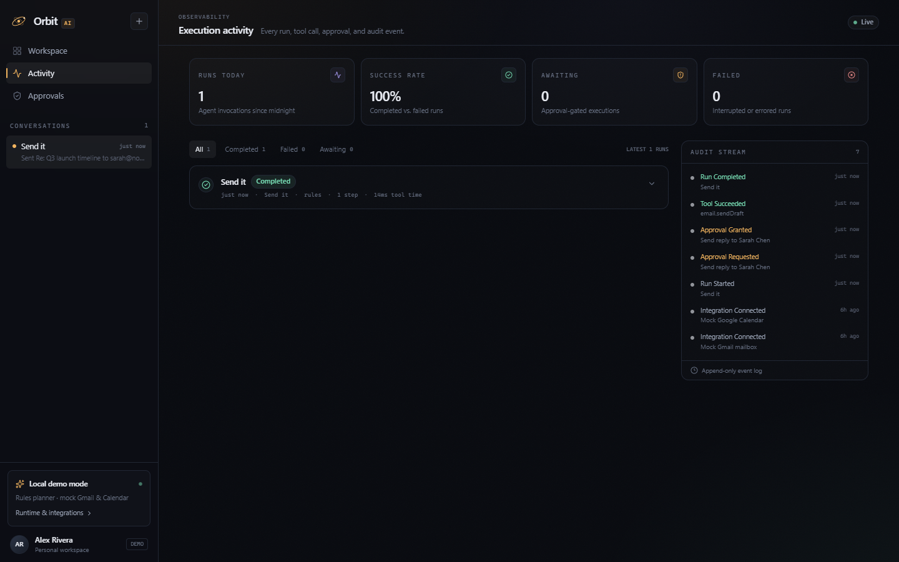

# Orbit AI — Personal Agent Workspace

A full-stack AI productivity assistant that turns natural-language requests into observable, approval-gated actions across email, calendar, and follow-up workflows.

Orbit is built as a working vertical slice, not a chatbot demo: every request becomes a persistent run with a validated plan, per-step execution traces, durable state, and an audit trail. Outbound actions stop and wait for a human.

**Stack:** TypeScript · Next.js 16 · React 19 · Convex 1.47 · Tailwind CSS 4 · Zod · Vitest · Playwright



## What it does

- **Model-first planning** — an OpenAI-compatible function-calling loop that sees tool results between turns, chains calls, and grounds its answer in what actually ran. A deterministic pattern interpreter covers the same tools when no model is configured.
- **Agent workspace** — conversational UI with reactive run state, inline tool traces, and resumable approval pauses.
- **Email intelligence** — search, summarize, draft replies, and send only after explicit approval.
- **Calendar intelligence** — list upcoming events, detect overlaps, and build meeting prep briefs from event data plus related email.
- **Follow-ups** — create and list tracked tasks that survive reloads.
- **Approval queue** — sensitive tools pause before execution; approve to run once, decline to end the run with no side effects.
- **Observability** — run statistics, expandable execution traces, tool arguments/results, errors, and an append-only audit stream.
- **Clarification instead of guessing** — when a request is ambiguous (several threads, no clear recipient) the planner asks one question with clickable options; when a model-selected tool call is missing a required argument, the run asks for that field instead of failing or running the tool incomplete.
- **Honest about its own capability** — with no provider configured, a request the built-in patterns cannot ground is answered with an explicit statement that no model is available, not a guess.
- **Deterministic demo** — complete mock Gmail and Calendar adapters, plus a scripted OpenAI-compatible fixture server for testing the model path without a key.

| Approval gate | Execution trace |
| --- | --- |
|  |  |

## Quick start

Requirements: Node.js 20+ and npm. Convex 1.47 can create an anonymous **local** deployment, so no Convex account is required.

```bash
git clone <your-repo-url> orbit
cd orbit
npm install

# Terminal 1 — local Convex backend (writes NEXT_PUBLIC_CONVEX_URL to .env.local)
npx convex dev

# Terminal 2 — Next.js
npm run dev
```

Open <http://localhost:3000>. On first load the workspace seeds itself with mock inbox threads, events, tasks, a ready-to-send draft, and a welcome conversation.

> If port 3000 is busy, run `npx next dev -p 3077`. Playwright's config uses 3077 by default.

### Try the demo

1. **“What needs my attention?”** — searches the inbox, summarizes the two threads that need a reply, and records three tool executions.
2. **“Prepare me for my next meeting”** — builds a brief from the next event, attendees, agenda, and related email.
3. **“Send it”** — pauses before sending the seeded draft. The approval card shows the exact recipient, subject, and body. Approve to execute; the trace, audit log, and mock thread update.
4. **“Add a follow-up with Marcus about the pricing page tomorrow”** — creates a task with a due date.
5. **“Do I have any conflicts tomorrow?”** — finds the deliberate calendar overlap in the fixtures.

The suggestion chips and right-hand context rail trigger the same requests.

## Architecture

```text
Next.js UI (client)
   │  Convex queries (reactive)          Convex actions
   ▼                                     ▼
Thread view  ◄──────────────────  Orchestrator
                                    │ 1. persist user message + run
                                    │ 2. load context + earlier tool results
                                    │ 3. loop: planner decision (tools | reply | ask)
                                    │ 4. validate each step with Zod
                                    │ 5. execute safe steps via WorkspacePort
                                    │ 6. feed results back, plan the next turn
                                    │ 7. pause at approval-gated steps
                                    │ 8. persist traces, summary, audit events
                                    ▼
                             Mock Gmail / Calendar adapters
```

The agent never calls integrations directly. Tools receive a typed [`WorkspacePort`](convex/lib/types.ts) that is implemented by database-backed mock adapters in Convex and by an in-memory adapter in tests. Real Gmail and Google Calendar adapters can implement the same interface without changing the planner or the UI.

### Request lifecycle

1. `orchestrator.sendMessage` creates the user message and an `agentRuns` record, then resolves the provider from the deployment environment.
2. The planner returns a typed decision: **run these tools**, **answer directly**, or **ask one clarifying question**.
3. Every step is validated against its Zod schema before execution. A rejected step fails the run with `plan_invalid` instead of silently disappearing.
4. Tool results return to the planner as structured observations, and it plans again — at most 3 turns and 4 new steps per turn. This is what makes “search, then summarize, then answer” work without hard-coded commands.
5. Read-only tools retry once on a transient failure with bounded backoff. Tools with side effects, and approved outbound actions, never retry. A step that already succeeded is never executed twice in one run.
6. A sensitive tool creates a pending execution + approval and stops the run. Approving resumes it in a separate action with the earlier observations intact; declining finalizes it with no side effects.
7. Progress (`activity`), plans, results, durations, attempts, structured error codes, and audit events are persisted and rendered reactively. Failures surface a code (`provider_rejected`, `provider_timeout`, `plan_invalid`, `tool_failed`, …) rather than a generic message.

### Tool registry

| Tool | Category | Approval | Purpose |
| --- | --- | --- | --- |
| `email.searchThreads` | email | no | Search by sender, subject, body, or attention flag |
| `email.summarizeThread` | email | no | Key points and latest message for a thread |
| `email.draftReply` | email | no | Create a reply draft; never sends |
| `email.sendDraft` | email | **yes** | Send an existing draft once |
| `calendar.listEvents` | calendar | no | Upcoming events in a window |
| `calendar.prepBrief` | calendar | no | Meeting brief from event + related email |
| `calendar.findConflicts` | calendar | no | Detect overlapping events |
| `tasks.createFollowUp` | tasks | no | Create a tracked follow-up |
| `tasks.listOpen` | tasks | no | List open follow-ups |
| `askUser` | planner | — | Decision tool: ask one clarifying question with 2–4 options. Never executed. |

Tool metadata lives in [`convex/lib/tools.ts`](convex/lib/tools.ts); the same registry generates the LLM function schemas, the UI tool catalog, and runtime validation. `askUser` is a *decision* tool, not an adapter: the loop turns it into a question with clickable options and executes nothing.

### Persistence

Convex tables: `threads`, `messages`, `agentRuns`, `executions`, `approvals`, `auditEvents`, plus the mock integration tables `mailThreads`, `drafts`, `calendarEvents`, `tasks`, and `appMeta`.

Run states: `running → awaiting_approval → completed | failed`.
Execution states: `running | awaiting_approval | succeeded | failed | rejected`.
Approval states: `pending | approved | rejected`.

Duplicate protection is enforced at two levels: approved executions are only run while in `awaiting_approval`, and the mock send adapter rejects drafts already marked `sent`.

## Planning: model first, patterns as a fallback

There is one planner contract and two implementations:

| Planner | When it runs | Natural language | Recorded as |
| --- | --- | --- | --- |
| `llmDecision` — OpenAI-compatible function calling | a provider is configured | yes: arbitrary requests, tool choice, clarification | `llm:<model>` |
| `rulesPlanner` — grounded pattern interpreter | no key is configured | no: a small set of request shapes | `rules` |

With a key configured the patterns are never used as an answer. A provider failure retries once, then fails the run with a typed error code and a Retry control — it is not described as an answer.

The workspace header and the settings page read `api.runtime.status`, which reports what is *actually* configured: model, provider host, and env var name — never the key. Without a key the header says **Built-in planner** and the settings page states which requests that cannot cover.

```bash
npx convex env set OPENAI_API_KEY sk-...
# Optional: defaults to gpt-5.6-terra, a supported function-calling model
npx convex env set OPENAI_MODEL gpt-5.6-terra
# Optional, for an OpenAI-compatible gateway (e.g. OpenRouter with an openai/... model id):
npx convex env set OPENAI_BASE_URL https://openrouter.ai/api/v1
# Optional: override the reasoning effort sent with the request
npx convex env set OPENAI_REASONING_EFFORT none
# Optional: cap completion tokens (defaults to 1200)
npx convex env set OPENAI_MAX_TOKENS 1200
```

The request to `/chat/completions` carries the system contract, the last eight conversation messages, a context digest with real thread/event/draft ids, earlier tool results, and the tool catalog (`tools`, `tool_choice: "auto"`). Every request is bounded by `max_tokens` (`OPENAI_MAX_TOKENS`, default 1200) — aggregators such as OpenRouter reserve credit for the model's full context window when the limit is absent and reject an otherwise usable balance with a 402. Reasoning-family models (gpt-5.6 / gpt-6) get `reasoning_effort: "none"` for low-latency tool calling; other models keep `temperature: 0`. Requests time out after 60 seconds, runs are capped at three planner turns and four steps per turn, and input is limited to 4,000 characters.

Model-selected steps pass through the same validation and approval gate as pattern-selected ones. Transient failures (timeout, throttling 429, 5xx) retry once with backoff; a rejected credential or malformed request does not retry. A 429 that reports an exhausted balance is not throttling — it is recorded as `provider_quota_exhausted`, never retried, and the run says the account needs credits rather than asking the user to wait. A 402 from an aggregator follows the same path. Either way the run ends as `failed` with an error code, a user-readable explanation, and the failure in the trace — never a silent pattern answer.

### Verifying the model path without a real key

[`tests/fixtures/mock-llm-server.mjs`](tests/fixtures/mock-llm-server.mjs) is a scripted OpenAI-compatible server. It answers from the observations the runtime sends, so a successful multi-turn exchange proves the loop, not just the HTTP wiring. When the request sets `stream: true` it replies with `text/event-stream` deltas and splits long tool arguments across fragments, exercising the same reassembly path a real provider uses. Its `follow-up` branch deliberately omits a required argument so the missing-argument clarification can be checked by hand.

```bash
node tests/fixtures/mock-llm-server.mjs

npx convex env set OPENAI_API_KEY mock-key
npx convex env set OPENAI_BASE_URL http://127.0.0.1:4599/v1
npx convex env set OPENAI_MODEL mock-orbit

# drive the app, then restore the default state
npx convex env unset OPENAI_API_KEY
npx convex env unset OPENAI_BASE_URL
npx convex env unset OPENAI_MODEL
```

## Scripts

| Command | Description |
| --- | --- |
| `npm run dev` | Next.js dev server |
| `npm run dev:backend` | Convex dev deployment + watcher |
| `npm run build` | Production build |
| `npm run typecheck` | TypeScript project check |
| `npm test` | Vitest unit suite |
| `npm run test:e2e` | Playwright end-to-end suite (starts backend + app) |
| `npm run test:e2e:ui` | Playwright interactive UI mode |
| `npm run test:e2e:report` | Open the last HTML report |

### Tests

- **Vitest** — `tests/agent.test.ts` covers planner routing (including the regression where “summarize” fell through to a search), follow-up resolution against prior results, ambiguity handling, schema validation, approval-gated tool metadata, draft/send execution, duplicate-send protection, meeting briefs, conflict detection, reply composition, and provider configuration. `tests/agent-loop.test.ts` covers the loop itself: observation feedback, the duplicate-step guard, approval pauses, structured failures, turn budgets, clarification, progress callbacks, and resume indices. `tests/llm-planner.test.ts` drives the model planner against a stubbed provider: validated plans, malformed-JSON and schema-invalid calls, an all-invalid plan failure, clarification, missing-argument clarification, reply decisions, observation passthrough, HTTP/401/500 errors, timeouts, and missing completions — no real model calls. `tests/conversation.test.ts` runs the whole conversation path end to end against a scripted streaming provider — the real planner, loop, tool registry, and in-memory workspace port, with no network: a plain question answered without tools, unfamiliar phrasing mapped to a validated tool call, a two-turn chain grounded in the tool result, conversation history carrying a correction, a missing argument turned into a question, an out-of-range call dropped while the valid one runs, a mid-stream cancel, an unusable body, a 429, a repeated tool call that executes once, and an approval-gated send that never executes on the spot. `tests/provider.test.ts` covers provider resolution (including that descriptors never contain the key), status-code classification, backoff, and user-facing error copy. `tests/authz.test.ts` covers the session boundary: a malformed session id is rejected and another session's conversation is refused. `tests/run-guard.test.ts` covers the duplicate-submission guard: a second message waits while a run is active or an approval is pending, and an interrupted run cannot lock a conversation forever. `tests/llm-planner.test.ts` also covers the bounded retry: a 429 retries once and succeeds, a 401 never retries, and repeated timeouts stop at the attempt budget.
- **Playwright** (`tests/e2e/`) covers the shell on desktop and mobile (`smoke.spec.ts`), the stateful triage/approval flow (`workspace.spec.ts`), and an interactive-element regression suite (`regression/`) for navigation, composer validation, approvals, activity filters/traces, context-rail actions, and demo reset. `regression/agent-workflows.spec.ts` covers the agent loop end to end: single-submission guarantees (including rapid repeated clicks), in-flight progress UI, mid-session connection drops, tool trace status/arguments/results, history across navigation, new-conversation state, and approval-gated sends with persisted results. Each regression test reseeds the deterministic mock workspace through the app's reset control.
- The context-rail summarize case that used to be marked `test.fail()` now asserts the fixed routing: the trace must show exactly one `email.summarizeThread` step and no run error.

```bash
npm test

# One-time browser install (bundled Chromium + ffmpeg for video capture)
npx playwright install chromium

npm run test:e2e
npm run test:e2e:ui       # interactive UI mode
npm run test:e2e:report   # open playwright-report/index.html
```

**How the runner starts the app.** Playwright runs `npx convex dev --start "npm run dev -- -p 3077"`, so the Convex backend is pushed and `.env.local` is written before Next.js boots. You do not need to start either process yourself. If a server is already listening on :3077, it is reused locally (never in CI). Set `PLAYWRIGHT_BASE_URL` to target an already-running deployment instead and no processes are managed.

| Variable | Default | Purpose |
| --- | --- | --- |
| `PLAYWRIGHT_BASE_URL` | `http://localhost:3077` | Target URL; skips process management |
| `PLAYWRIGHT_PORT` | `3077` | Port used when Playwright starts Next |
| `PLAYWRIGHT_CHANNEL` | bundled Chromium | Use an installed browser, e.g. `chrome` |
| `CI` | unset | Retries ×2, `forbidOnly`, JUnit + HTML artifacts |

**Projects:** `desktop-chromium` (Desktop Chrome) and `mobile-chromium` (Pixel 7). The stateful `workspace.spec.ts` runs on desktop only, because it drives the desktop sidebar and resets the shared demo dataset; the smoke suite runs on both.

**Failure artifacts:** screenshots, traces, and video for failed tests land in `test-results/`; the HTML report is written to `playwright-report/`. Both are git-ignored. Open a trace with `npx playwright show-trace test-results/<test>/trace.zip`.

## Project structure

```text
app/                    Next.js App Router: workspace, activity, approvals, settings
  layout.tsx            Shell, fonts, theme + Convex providers
  page.tsx              Workspace route
  globals.css           Tailwind 4 theme tokens
components/             Chat, composer, approval cards, traces, sidebar, UI primitives
  ui/                   Shared primitives (button, badge, status)
convex/                 Server: schema, actions, queries, mutations
  schema.ts             Tables, indexes, validators
  orchestrator.ts       Public actions: plan, execute, approve, resume, regenerate
  agent.ts              Run / execution / approval persistence
  chat.ts               Thread + message reads for the UI
  messages.ts           Message preparation (edit, regenerate)
  threads.ts            Thread lifecycle
  workspace.ts          Mock adapter data access + context queries
  runtime.ts            Secret-free planner status query
  approvals.ts          Approval listing and decisions
  activity.ts           Run traces, statistics, audit stream
  ownership.ts          Per-session scoping of threads and runs
  seed.ts               Deterministic demo fixtures + reset
  lib/
    agentLoop.ts        Plan → execute → observe loop, duplicate guard, budget
    tools.ts            Typed tool registry, Zod schemas, LLM function schemas
    planner.ts          Grounded pattern interpreter (fallback) + reply composition
    llmPlanner.ts       Multi-turn OpenAI-compatible calls, bounded retries
    llmProvider.ts      Provider resolution + safe status descriptor
    stream.ts           SSE reader for text deltas and tool-call fragments
    policy.ts           Which tools may run without approval
    authz.ts            Session boundary for conversation isolation
    runGuard.ts         Duplicate submission / stale run guards
    errors.ts           Structured errors, retry policy, user-facing copy
    types.ts            Decisions, observations, ToolDefinition, WorkspacePort
  _generated/           Convex codegen (committed, regenerated by convex dev)
lib/                    Client helpers: formatting, view types, session id, tool labels
tests/                  Vitest unit tests + Playwright E2E
  fixtures/             Scripted OpenAI-compatible provider
  helpers/              In-memory WorkspacePort
  e2e/regression/       Interactive-element regression suite
scripts/                ui-audit.mjs — responsive/visual audit helper
screenshots/            README images
.env.example            Environment template (placeholders only)
```

## Security notes

- Sensitive tools are enforced server-side; the UI cannot bypass an approval by calling a mutation.
- Tool arguments are validated before any adapter is invoked.
- Approval decisions are recorded with actor, timestamp, and a link to the execution.
- Audit events are append-only from the app's perspective.
- LLM credentials live in the Convex deployment environment.
- The seeded Gmail/Calendar data is local and deterministic; no real mailbox is contacted.
- **This is a single-user demo without authentication.** Do not deploy it as a multi-user service before adding auth, per-user ownership checks, and real integration OAuth.

## Limitations and next steps

- Replace the mock `WorkspacePort` implementations with Gmail and Google Calendar OAuth adapters.
- Add authentication and per-user data isolation; approvals and audit events currently assume one person.
- Streaming is incremental per turn: the provider's deltas are written into the assistant message (throttled) so text appears while the model is still talking, but the transport is a single Convex action rather than a socket the client owns.
- Add approval policies by tool/risk level and expiring requests.
- Persist plan revisions and support richer multi-turn re-planning after tool results.

## Roadmap status

- [x] Dashboard and conversational interface
- [x] Convex schemas and persistent conversations
- [x] Typed tool registry with argument validation
- [x] Mock email and calendar adapters
- [x] Agent orchestration loop
- [x] Model-first planner with a multi-turn tool loop, clarification, and typed provider failures
- [ ] Gmail and Calendar OAuth (adapter boundary in place)
- [x] Approval-gated actions
- [x] Execution traces and audit history
- [x] Unit and end-to-end tests
- [x] Working local demo and architecture documentation

## Contributing

Issues and pull requests are welcome. Before opening one, run the checks this repo is verified with:

```bash
npm run typecheck   # tsc --noEmit
npm test            # Vitest unit + integration suite
npm run test:e2e    # Playwright, starts the backend and app itself
npm run build       # production build
```

Keep secrets out of commits: model credentials go in the Convex deployment environment, and `.env*` (except `.env.example`) is ignored.

## License

Released under the [MIT License](LICENSE).
